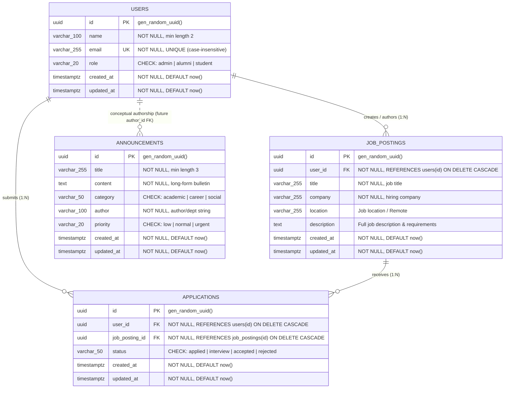

# Data Design Document (DDD)
## Alumni Tracking System — Relational Schema, Multi-Entity Associations & Persistence (Weeks 5 & 6)

> 🔗 **Bidirectional Documentation Link**:
> This document specifies the persistent data tier, relational schemas, constraints, and index strategy for the system described in the main [README.md](./README.md).
> To return to the main project overview, architecture diagrams, and API guides, see [README.md](./README.md).

---

## 📋 Table of Contents

1. [Executive Summary & Purpose](#1-executive-summary--purpose)
2. [Infrastructure & Persistence Model](#2-infrastructure--persistence-model)
3. [Entity Schema Specifications](#3-entity-schema-specifications)
   - [3.1 Entity: `users`](#31-entity-users)
   - [3.2 Entity: `announcements`](#32-entity-announcements)
   - [3.3 Entity: `job_postings` (Week 6 — One-to-Many)](#33-entity-job_postings-week-6--one-to-many)
   - [3.4 Entity: `applications` (Week 6 — Many-to-Many Join Entity)](#34-entity-applications-week-6--many-to-many-join-entity)
4. [Data Types, Constraints & Referential Integrity Matrix](#4-data-types-constraints--referential-integrity-matrix)
   - [4.1 Global Design Conventions](#41-global-design-conventions)
   - [4.2 Referential Integrity & Cascade Rules (ON DELETE CASCADE)](#42-referential-integrity--cascade-rules-on-delete-cascade)
   - [4.3 Duplicate Application Prevention & 409 Conflict Rule](#43-duplicate-application-prevention--409-conflict-rule)
5. [Indexing Strategy & Performance Analysis](#5-indexing-strategy--performance-analysis)
   - [5.1 `users` Table Indexes](#51-users-table-indexes)
   - [5.2 `announcements` Table Indexes](#52-announcements-table-indexes)
   - [5.3 `job_postings` Table Indexes](#53-job_postings-table-indexes)
   - [5.4 `applications` Table Indexes](#54-applications-table-indexes)
6. [Relational Associations & Architectural Rationale](#6-relational-associations--architectural-rationale)
   - [6.1 One-to-Many (1:N) Association: `users` ───< `job_postings`](#61-one-to-many-1n-association-users----job_postings)
   - [6.2 Many-to-Many (N:M) Association: `users` >───< `job_postings` via `applications`](#62-many-to-many-nm-association-users----job_postings-via-applications)
   - [6.3 Standalone `announcements.author` Design](#63-standalone-announcementsauthor-design)
7. [Entity-Relationship (ER) Diagram](#7-entity-relationship-er-diagram)
8. [PostgreSQL DDL Reference Scripts](#8-postgresql-ddl-reference-scripts)
   - [8.1 Migration 001: Initial Schema (`001_initial_schema.sql`)](#81-migration-001-initial-schema-001_initial_schemasql)
   - [8.2 Migration 002: Jobs & Applications (`002_jobs_and_applications.sql`)](#82-migration-002-jobs--applications-002_jobs_and_applicationssql)
9. [Environment Configuration & Secrets Strategy](#9-environment-configuration--secrets-strategy)
10. [Migration & Seed Strategy](#10-migration--seed-strategy)
11. [Navigation](#11-navigation)

---

## 1. Executive Summary & Purpose

In Weeks 3 and 4, the **Alumni Tracking System** operated using an in-memory repository architecture with thread-safe defensive deep cloning to satisfy strict instructor isolation milestones.

**Week 5 Milestone ("Database Integration, Persistence & Migration")** formalized the transition to an enterprise-grade **PostgreSQL 16** relational database engine with containerized orchestration and named volumes.

**Week 6 Milestone ("Relational Schema, One-to-Many & Many-to-Many Associations, and Nested Routing")** expands the data architecture to support complex multi-entity domain relationships:
1. **One-to-Many (1:N)**: A registered user (alumni, recruiter, or admin) can author and publish multiple career opportunities (`users (1) ───< (N) job_postings`).
2. **Many-to-Many (N:M)**: Registered users (candidates/students) can submit job applications to multiple job postings, and each job posting receives applications from multiple candidates (`users (N) >───< (M) job_postings` mediated by the `applications` join entity).
3. **Referential Integrity & Strict Cascade Deletions**: Deleting a user automatically cascades to their authored job postings and submitted applications; deleting a job posting cascades to its associated applications.
4. **Duplicate Prevention (Business Rule Enforcement)**: Enforces table-level uniqueness `CONSTRAINT uq_user_job_application UNIQUE (user_id, job_posting_id)` to guarantee that candidates can apply to a specific vacancy at most once, backing the application layer's `409 Conflict` response.

---

## 2. Infrastructure & Persistence Model

### 2.1 Topology & Container Orchestration

The database engine is deployed as an isolated microservice container within Docker Compose:

* **Container / Service Name**: `alumni_postgres`
* **Base Image**: `postgres:16-alpine` (lightweight, minimal attack surface, security audited)
* **Isolated Network**: `alumni_network` (bridge network shared with `alumni_backend`)
* **Default Port**: `5432` (mapped dynamically via `${DB_PORT:-5432}:5432`)
* **Persistent Named Volume**: `postgres_data` mapped to `/var/lib/postgresql/data`

### 2.2 Persistence Guarantee (Named Docker Volume)

Ephemeral container lifecycles must **never** lead to data loss. The database configuration enforces persistence via a top-level named volume:

```yaml
services:
  alumni_postgres:
    image: postgres:16-alpine
    container_name: alumni_postgres
    restart: unless-stopped
    volumes:
      - postgres_data:/var/lib/postgresql/data
    healthcheck:
      test: ["CMD-SHELL", "pg_isready -U ${DB_USER:-alumni_user} -d ${DB_NAME:-alumni_db}"]
      interval: 5s
      timeout: 5s
      retries: 5
      start_period: 10s

volumes:
  postgres_data:
    driver: local
```

* **Durability Guarantee**: PostgreSQL WAL (Write-Ahead Logging) files, system catalogs, and table data reside inside the named volume `postgres_data`. Stopping (`docker compose down`), rebuilding images (`--build`), or restarting containers preserves all persistent state.
* **Volume Isolation**: The named volume is isolated from the host filesystem's working directory, preventing accidental modification, host OS permissions collisions, or git commits of binary database files.

### 2.3 Dependency & Health Coordination

The backend service coordinates startup using Docker's native healthcheck probe:

```yaml
backend:
  depends_on:
    alumni_postgres:
      condition: service_healthy
```

The healthcheck executes `pg_isready -U ${DB_USER:-alumni_user} -d ${DB_NAME:-alumni_db}` every 5 seconds. The backend container boots only after PostgreSQL has initialized the database catalog, started the TCP listener on port 5432, and reported ready to accept client connections.

---

## 3. Entity Schema Specifications

### 3.1 Entity: `users`

The `users` entity models registered alumni, students, and administrators within the system.

#### Table Definition
* **Table Name**: `users`
* **Primary Key**: `id` (`UUID`)

#### Column Specifications

| Column Name | PostgreSQL Type | Nullable | Default | Constraints & Checks | Rationale |
| :--- | :--- | :--- | :--- | :--- | :--- |
| `id` | `UUID` | **NOT NULL** | `gen_random_uuid()` | `PRIMARY KEY` | Globally unique 128-bit RFC 4122 identifier. Mitigates enumeration attacks and decouples identity from storage order. |
| `name` | `VARCHAR(100)` | **NOT NULL** | *None* | `CHECK (LENGTH(TRIM(name)) >= 2)` | Enforces human-readable names with a reasonable upper boundary (100 chars) and minimum 2 chars. |
| `email` | `VARCHAR(255)` | **NOT NULL** | *None* | `UNIQUE`, RFC email regex | RFC 5321 compliant email address. Unique index prevents duplicate accounts. |
| `role` | `VARCHAR(20)` | **NOT NULL** | `'student'` | `CHECK (role IN ('admin', 'alumni', 'student'))` | Role-Based Access Control (RBAC) discriminator. Constrained to enumerated valid roles. |
| `created_at` | `TIMESTAMPTZ` | **NOT NULL** | `CURRENT_TIMESTAMP` | *Immutable on update* | UTC timestamp recording record creation instant. |
| `updated_at` | `TIMESTAMPTZ` | **NOT NULL** | `CURRENT_TIMESTAMP` | *Updated via trigger* | UTC timestamp capturing the latest record mutation. |

---

### 3.2 Entity: `announcements`

The `announcements` entity models institution-wide bulletins, career fairs, academic notices, and alumni networking opportunities.

#### Table Definition
* **Table Name**: `announcements`
* **Primary Key**: `id` (`UUID`)

#### Column Specifications

| Column Name | PostgreSQL Type | Nullable | Default | Constraints & Checks | Rationale |
| :--- | :--- | :--- | :--- | :--- | :--- |
| `id` | `UUID` | **NOT NULL** | `gen_random_uuid()` | `PRIMARY KEY` | 128-bit UUID primary key ensuring collision-free identification across distributed environments. |
| `title` | `VARCHAR(255)` | **NOT NULL** | *None* | `CHECK (LENGTH(TRIM(title)) >= 3)` | Headline of the bulletin. 255 characters accommodate descriptive headlines. |
| `content` | `TEXT` | **NOT NULL** | *None* | `CHECK (LENGTH(TRIM(content)) > 0)` | Unbounded long-form textual body accommodating multi-paragraph announcements or rich markdown. |
| `category` | `VARCHAR(50)` | **NOT NULL** | *None* | `CHECK (category IN ('academic', 'career', 'social'))` | Categorical discriminator supporting UI tab filters and notification channels. |
| `author` | `VARCHAR(100)` | **NOT NULL** | *None* | `CHECK (LENGTH(TRIM(author)) >= 2)` | Author or issuing institutional entity (e.g. "Career Development Center", "Alumni Relations Office"). |
| `priority` | `VARCHAR(20)` | **NOT NULL** | `'normal'` | `CHECK (priority IN ('low', 'normal', 'urgent'))` | Urgency classification for badge colorization and sorting. |
| `created_at` | `TIMESTAMPTZ` | **NOT NULL** | `CURRENT_TIMESTAMP` | *Immutable on update* | Timezone-aware UTC timestamp used for reverse-chronological feed sorting. |
| `updated_at` | `TIMESTAMPTZ` | **NOT NULL** | `CURRENT_TIMESTAMP` | *Updated via trigger* | Timezone-aware UTC timestamp recording the latest edit time. |

---

### 3.3 Entity: `job_postings` (Week 6 — One-to-Many)

The `job_postings` entity models professional vacancies, employment listings, and internship opportunities posted by registered users (alumni, recruiters, administrators).

#### Table Definition
* **Table Name**: `job_postings`
* **Primary Key**: `id` (`UUID`)
* **Foreign Key**: `user_id` (`UUID`) REFERENCES `users(id)` ON DELETE CASCADE

#### Column Specifications

| Column Name | PostgreSQL Type | Nullable | Default | Constraints & Checks | Rationale |
| :--- | :--- | :--- | :--- | :--- | :--- |
| `id` | `UUID` | **NOT NULL** | `gen_random_uuid()` | `PRIMARY KEY` | Globally unique 128-bit RFC 4122 identifier. |
| `user_id` | `UUID` | **NOT NULL** | *None* | `REFERENCES users(id) ON DELETE CASCADE` | Identifies the authoring user who published the vacancy. Cascade deletion automatically removes postings when user account is deleted. |
| `title` | `VARCHAR(255)` | **NOT NULL** | *None* | *Required string* | Position title (e.g. "Senior Backend Engineer", "Data Analyst Intern"). |
| `company` | `VARCHAR(255)` | **NOT NULL** | *None* | *Required string* | Hiring company, organization, or startup name. |
| `location` | `VARCHAR(255)` | **NULL** | *None* | *Optional string* | Physical office location or work arrangement (e.g. "San Francisco, CA", "Hybrid", "Remote"). |
| `description` | `TEXT` | **NULL** | *None* | *Optional long-form* | Comprehensive job description, qualifications, compensation range, and responsibilities. |
| `created_at` | `TIMESTAMPTZ` | **NOT NULL** | `NOW()` | *Immutable on update* | UTC timestamp used for chronological job feed sorting (`ORDER BY created_at DESC`). |
| `updated_at` | `TIMESTAMPTZ` | **NOT NULL** | `NOW()` | *Updated via trigger* | UTC timestamp capturing the latest vacancy description update. |

---

### 3.4 Entity: `applications` (Week 6 — Many-to-Many Join Entity)

The `applications` entity represents the relational join junction between `users` (candidates/applicants) and `job_postings`. It maintains application lifecycle states and guarantees duplicate application prevention.

#### Table Definition
* **Table Name**: `applications`
* **Primary Key**: `id` (`UUID`)
* **Foreign Keys**:
  * `user_id` (`UUID`) REFERENCES `users(id)` ON DELETE CASCADE
  * `job_posting_id` (`UUID`) REFERENCES `job_postings(id)` ON DELETE CASCADE
* **Composite Unique Constraint**: `CONSTRAINT uq_user_job_application UNIQUE (user_id, job_posting_id)`

#### Column Specifications

| Column Name | PostgreSQL Type | Nullable | Default | Constraints & Checks | Rationale |
| :--- | :--- | :--- | :--- | :--- | :--- |
| `id` | `UUID` | **NOT NULL** | `gen_random_uuid()` | `PRIMARY KEY` | Independent UUID for each distinct application submission. |
| `user_id` | `UUID` | **NOT NULL** | *None* | `REFERENCES users(id) ON DELETE CASCADE` | The candidate submitting the application. Deletion of applicant cascades and cleans up submitted applications. |
| `job_posting_id` | `UUID` | **NOT NULL** | *None* | `REFERENCES job_postings(id) ON DELETE CASCADE` | The target vacancy. Deletion of the job posting cascades and removes all related applications. |
| `status` | `VARCHAR(50)` | **NOT NULL** | `'applied'` | `CHECK (status IN ('applied', 'interview', 'accepted', 'rejected'))` | Controlled application workflow state discriminator. Defaults to `'applied'`. |
| `created_at` | `TIMESTAMPTZ` | **NOT NULL** | `NOW()` | *Immutable on update* | UTC timestamp recording application submission moment. |
| `updated_at` | `TIMESTAMPTZ` | **NOT NULL** | `NOW()` | *Updated via trigger* | UTC timestamp recording status transitions (e.g., moved to `'interview'`). |

---

## 4. Data Types, Constraints & Referential Integrity Matrix

### 4.1 Global Design Conventions

1. **UUID Identifier Standard**: All primary keys utilize native PostgreSQL `UUID` generated by `gen_random_uuid()`.
2. **Explicit Timezone Representation**: Timestamps use `TIMESTAMPTZ` (`TIMESTAMP WITH TIME ZONE`), internally normalized to UTC.
3. **Defense-in-Depth Constraints**: Data integrity is enforced at the database level (`NOT NULL`, `CHECK`, `UNIQUE`, `FOREIGN KEY ... ON DELETE CASCADE`).
4. **Automated Mutation Tracking**: PostgreSQL trigger `update_updated_at_column()` automatically sets `updated_at = NOW()` on every `UPDATE` operation across `job_postings` and `applications`.

### 4.2 Referential Integrity & Cascade Rules (`ON DELETE CASCADE`)

```
  ┌─────────────────────────────────────────────────────────┐
  │                          USERS                          │
  └─────────────┬─────────────────────────────┬─────────────┘
                │                             │
       ON DELETE CASCADE             ON DELETE CASCADE
                │                             │
                ▼                             ▼
  ┌───────────────────────────┐ ┌───────────────────────────┐
  │       JOB_POSTINGS        │ │       APPLICATIONS        │
  └─────────────┬─────────────┘ └─────────────▲─────────────┘
                │                             │
                └────── ON DELETE CASCADE ────┘
```

1. **User Deletion Cascades to Job Postings**:
   - `job_postings.user_id REFERENCES users(id) ON DELETE CASCADE`
   - *Rationale*: If an author or recruiter account is purged from the platform, their published vacancies are automatically deleted, preventing phantom postings with missing author references.
2. **User Deletion Cascades to Applications**:
   - `applications.user_id REFERENCES users(id) ON DELETE CASCADE`
   - *Rationale*: If a candidate user account is deleted (e.g. GDPR right-to-erasure), all of their submitted job applications are automatically cleaned up.
3. **Job Posting Deletion Cascades to Applications**:
   - `applications.job_posting_id REFERENCES job_postings(id) ON DELETE CASCADE`
   - *Rationale*: If an employer closes and deletes a job posting, all applications filed against that vacancy are purged, eliminating orphan join records.

### 4.3 Duplicate Application Prevention & 409 Conflict Rule

* **Table Constraint**:
  ```sql
  CONSTRAINT uq_user_job_application UNIQUE (user_id, job_posting_id)
  ```
* **Database Invariant**: A specific user can apply to a given job posting at most once.
* **HTTP 409 Conflict Business Rule**:
  - When an application submission (`POST /api/jobs/:id/applications` or `POST /api/users/:userId/applications`) attempts to insert an existing `(user_id, job_posting_id)` pair, PostgreSQL throws error code `23505 (unique_violation)`.
  - The application service and controller layer traps this error code and returns an HTTP `409 Conflict` status code:
    ```json
    {
      "status": "error",
      "statusCode": 409,
      "message": "User has already applied to this job posting"
    }
    ```

---

## 5. Indexing Strategy & Performance Analysis

```
┌────────────────────────────────────────────────────────────────────────┐
│                        PostgreSQL B-Tree Indexes                       │
├──────────────────────────┬───────────────────────┬─────────────────────┤
│ Table                    │ Index Name            │ Indexed Expression  │
├──────────────────────────┼───────────────────────┼─────────────────────┤
│ users                    │ users_pkey            │ (id) UNIQUE         │
│ users                    │ idx_users_email_lower │ (LOWER(email)) UNIQ │
│ users                    │ idx_users_role        │ (role)              │
│ announcements            │ announcements_pkey    │ (id) UNIQUE         │
│ announcements            │ idx_announcements_cr  │ (created_at DESC)   │
│ announcements            │ idx_announcements_cat │ (category, created) │
│ announcements            │ idx_announcements_pri │ (priority)          │
│ job_postings             │ job_postings_pkey     │ (id) UNIQUE         │
│ job_postings             │ idx_jobs_user_id      │ (user_id)           │
│ job_postings             │ idx_jobs_created_at_d │ (created_at DESC)   │
│ applications             │ applications_pkey     │ (id) UNIQUE         │
│ applications             │ uq_user_job_applicat. │ (user_id, job_id) UN│
│ applications             │ idx_applications_user │ (user_id)           │
│ applications             │ idx_applications_job  │ (job_posting_id)    │
│ applications             │ idx_applications_stat │ (status)            │
└──────────────────────────┴───────────────────────┴─────────────────────┘
```

### 5.1 `users` Table Indexes
1. **`users_pkey`**: Primary key index on `id`. Fast $O(\log N)$ single-record retrieval.
2. **`idx_users_email_lower`**: Unique functional index on `LOWER(TRIM(email))`. Prevents duplicate email accounts regardless of casing.
3. **`idx_users_role`**: B-Tree index on `role` for directory filtering (`WHERE role = 'alumni'`).

### 5.2 `announcements` Table Indexes
1. **`announcements_pkey`**: Primary key index on `id`.
2. **`idx_announcements_created_at_desc`**: Reverse chronological index on `created_at DESC` for bulletin board feeds.
3. **`idx_announcements_category_created_at`**: Composite index on `(category, created_at DESC)`.
4. **`idx_announcements_priority`**: Filter index on `priority`.

### 5.3 `job_postings` Table Indexes
1. **`job_postings_pkey`**: Primary key index on `id`.
2. **`idx_jobs_user_id`**: Foreign key index on `job_postings(user_id)`.
   - *Query Profile*: Essential for nested routing queries such as `GET /api/users/:userId/jobs` (finding all vacancies posted by a specific user) and fast foreign key constraint validation during user deletion.
3. **`idx_jobs_created_at_desc`**: Descending B-Tree index on `job_postings(created_at DESC)`.
   - *Query Profile*: Powers the public job board feed (`SELECT * FROM job_postings ORDER BY created_at DESC LIMIT 20`), avoiding expensive runtime sorting.

### 5.4 `applications` Table Indexes
1. **`applications_pkey`**: Primary key index on `id`.
2. **`uq_user_job_application`**: Automatically backed by a unique B-Tree index on `(user_id, job_posting_id)` for duplicate check acceleration.
3. **`idx_applications_user_id`**: Foreign key index on `applications(user_id)`.
   - *Query Profile*: Powers candidate portal queries `GET /api/users/:userId/applications` (retrieving all applications submitted by a user).
4. **`idx_applications_job_id`**: Foreign key index on `applications(job_posting_id)`.
   - *Query Profile*: Vital for employer view queries `GET /api/jobs/:jobId/applications` (listing all candidates who applied for a specific job). Because the composite unique index has `user_id` as its leading column, queries filtering solely on `job_posting_id` require this dedicated index for sub-millisecond execution.
5. **`idx_applications_status`**: Filter index on `applications(status)`.
   - *Query Profile*: Enables efficient dashboard filtering by application lifecycle status (`WHERE status = 'interview'`).

---

## 6. Relational Associations & Architectural Rationale

### 6.1 One-to-Many (1:N) Association: `users` ───< `job_postings`

* **Cardinality**: One user can author zero, one, or many job postings. Each job posting belongs to exactly one authoring user.
* **Foreign Key**: `job_postings.user_id REFERENCES users(id) ON DELETE CASCADE`.
* **API Routing Blueprint**:
  - `GET /api/users/:userId/jobs`: Lists all vacancies published by user `:userId`.
  - `POST /api/users/:userId/jobs`: Creates a new job posting authored by user `:userId`.
  - `GET /api/jobs`: Public job catalog with optional filtering.
  - `GET /api/jobs/:id`: Detailed view of an individual job posting.

### 6.2 Many-to-Many (N:M) Association: `users` >───< `job_postings` via `applications`

* **Cardinality**: Many candidates (`users`) can apply to many vacancies (`job_postings`).
* **Relational Representation**: Mediated through the `applications` join entity.
  - `users (1) ───< (N) applications`
  - `job_postings (1) ───< (N) applications`
* **Lifecycle State Machine**:
  ```
  [ applied ] ───> [ interview ] ───> [ accepted ]
                         │
                         └───> [ rejected ]
  ```
* **API Routing Blueprint**:
  - `POST /api/jobs/:jobId/applications`: Submits an application for job `:jobId` (with candidate `user_id` in request body).
  - `GET /api/jobs/:jobId/applications`: Retrieves all applicant records for job `:jobId` (for recruiters/authors).
  - `GET /api/users/:userId/applications`: Retrieves all applications filed by candidate `:userId`.
  - `PATCH /api/applications/:id/status`: Updates application state (`applied`, `interview`, `accepted`, `rejected`).

### 6.3 Standalone `announcements.author` Design

In contrast to `job_postings` (which strictly ties to `users.id` for personal ownership), `announcements.author` remains a `VARCHAR(100)` string. This preserves institutional announcements authored by departments ("Alumni Relations Office", "School of Computing") that do not have dedicated user login accounts.

---

## 7. Entity-Relationship (ER) Diagram



---

## 8. PostgreSQL DDL Reference Scripts

### 8.1 Migration 001: Initial Schema (`001_initial_schema.sql`)

```sql
-- Migration 001: Initial Schema (users & announcements)
CREATE EXTENSION IF NOT EXISTS "pgcrypto";

CREATE TABLE IF NOT EXISTS users (
    id UUID PRIMARY KEY DEFAULT gen_random_uuid(),
    name VARCHAR(100) NOT NULL,
    email VARCHAR(255) NOT NULL UNIQUE,
    role VARCHAR(20) NOT NULL,
    created_at TIMESTAMPTZ DEFAULT NOW(),
    updated_at TIMESTAMPTZ DEFAULT NOW()
);

CREATE UNIQUE INDEX IF NOT EXISTS idx_users_email_lower ON users (LOWER(TRIM(email)));
CREATE INDEX IF NOT EXISTS idx_users_role ON users (role);

CREATE TABLE IF NOT EXISTS announcements (
    id UUID PRIMARY KEY DEFAULT gen_random_uuid(),
    title VARCHAR(255) NOT NULL,
    content TEXT NOT NULL,
    category VARCHAR(50) NOT NULL,
    author VARCHAR(100) NOT NULL,
    priority VARCHAR(20) NOT NULL,
    created_at TIMESTAMPTZ DEFAULT NOW(),
    updated_at TIMESTAMPTZ DEFAULT NOW()
);

CREATE INDEX IF NOT EXISTS idx_announcements_created_at_desc ON announcements (created_at DESC);
CREATE INDEX IF NOT EXISTS idx_announcements_category_created_at ON announcements (category, created_at DESC);
CREATE INDEX IF NOT EXISTS idx_announcements_priority ON announcements (priority);
```

### 8.2 Migration 002: Jobs & Applications (`002_jobs_and_applications.sql`)

```sql
-- Migration 002: Jobs & Applications (Week 6)
CREATE EXTENSION IF NOT EXISTS "pgcrypto";

CREATE OR REPLACE FUNCTION update_updated_at_column()
RETURNS TRIGGER AS $$
BEGIN
    NEW.updated_at = NOW();
    RETURN NEW;
END;
$$ LANGUAGE plpgsql;

-- 1:N Association: User -> Job Postings
CREATE TABLE IF NOT EXISTS job_postings (
    id UUID PRIMARY KEY DEFAULT gen_random_uuid(),
    user_id UUID NOT NULL REFERENCES users(id) ON DELETE CASCADE,
    title VARCHAR(255) NOT NULL,
    company VARCHAR(255) NOT NULL,
    location VARCHAR(255),
    description TEXT,
    created_at TIMESTAMPTZ DEFAULT NOW(),
    updated_at TIMESTAMPTZ DEFAULT NOW()
);

-- N:M Join Entity: Users <-> Job Postings via Applications
CREATE TABLE IF NOT EXISTS applications (
    id UUID PRIMARY KEY DEFAULT gen_random_uuid(),
    user_id UUID NOT NULL REFERENCES users(id) ON DELETE CASCADE,
    job_posting_id UUID NOT NULL REFERENCES job_postings(id) ON DELETE CASCADE,
    status VARCHAR(50) DEFAULT 'applied' CHECK (status IN ('applied', 'interview', 'accepted', 'rejected')),
    created_at TIMESTAMPTZ DEFAULT NOW(),
    updated_at TIMESTAMPTZ DEFAULT NOW(),
    CONSTRAINT uq_user_job_application UNIQUE (user_id, job_posting_id)
);

-- Indexes for FKs, filtering, and feed sorting
CREATE INDEX IF NOT EXISTS idx_jobs_user_id ON job_postings (user_id);
CREATE INDEX IF NOT EXISTS idx_jobs_created_at_desc ON job_postings (created_at DESC);
CREATE INDEX IF NOT EXISTS idx_applications_user_id ON applications (user_id);
CREATE INDEX IF NOT EXISTS idx_applications_job_id ON applications (job_posting_id);
CREATE INDEX IF NOT EXISTS idx_applications_status ON applications (status);

-- Automated updated_at Triggers
DROP TRIGGER IF EXISTS trigger_job_postings_updated_at ON job_postings;
CREATE TRIGGER trigger_job_postings_updated_at
    BEFORE UPDATE ON job_postings
    FOR EACH ROW
    EXECUTE FUNCTION update_updated_at_column();

DROP TRIGGER IF EXISTS trigger_applications_updated_at ON applications;
CREATE TRIGGER trigger_applications_updated_at
    BEFORE UPDATE ON applications
    FOR EACH ROW
    EXECUTE FUNCTION update_updated_at_column();
```

---

## 9. Environment Configuration & Secrets Strategy

### 9.1 Environment Variables Matrix

| Variable | Target Value | Container Context | Description |
| :--- | :--- | :--- | :--- |
| `DB_HOST` | `alumni_postgres` (or `127.0.0.1` locally) | `backend` | PostgreSQL database hostname |
| `DB_PORT` | `5432` | `backend` & `alumni_postgres` | Standard PostgreSQL port |
| `DB_NAME` | `alumni_db` | `backend` & `alumni_postgres` | Target database catalog name |
| `DB_USER` | `alumni_user` | `backend` & `alumni_postgres` | Application database user |
| `DB_PASSWORD` | `alumni_secure_password` | `backend` & `alumni_postgres` | High-entropy authentication password |

---

## 10. Migration & Seed Strategy

### 10.1 Sequential Transactional Migration Runner

Migrations are managed programmatically via `backend/src/db/migrate.js`:
* **Ledger Table**: Uses `schema_migrations (id SERIAL, version VARCHAR(255) UNIQUE, applied_at TIMESTAMPTZ)` to record each applied migration script.
* **Deterministic Sequencing**: Reads files from `backend/src/db/migrations/` and sorts them numerically/alphabetically (`001_initial_schema.sql`, `002_jobs_and_applications.sql`).
* **Atomic Transactions**: Each unapplied migration executes within an isolated `BEGIN ... COMMIT` block. Any error triggers a strict `ROLLBACK` and aborts server boot.
* **Idempotency**: Running `npm run migrate` repeatedly detects previously executed scripts and safely skips them.

### 10.2 Baseline Seed Data

Seed data is managed via `backend/src/db/seed.js` executing scripts in `backend/src/db/seeds/` using `ON CONFLICT (id) DO UPDATE` idempotency:
* **Initial Users**: Ada Lovelace (`admin`), Alan Turing (`alumni`), Grace Hopper (`alumni`), Margaret Hamilton (`student`).
* **Initial Bulletins**: Annual Alumni Homecoming, Fall Tech Career Fair, Quantum Computing Keynote.

---

## 11. Navigation

* ⬅️ **Return to Main Documentation**: [README.md](./README.md)
* 🗄️ **Database Design Section in README**: [README.md#database-design--persistence-documentation-dddmd](./README.md#-database-design--persistence-documentation-dddmd)
* 🏛️ **MVC Architecture & Dual Controllers**: [README.md#mvc-architecture-specification](./README.md#-mvc-architecture-specification)
* 🧪 **Automated Test Suite**: [README.md#local-development--testing](./README.md#-local-development--testing)
* 🐳 **Containerization Specification**: [README.md#containerization-details](./README.md#-containerization-details)
