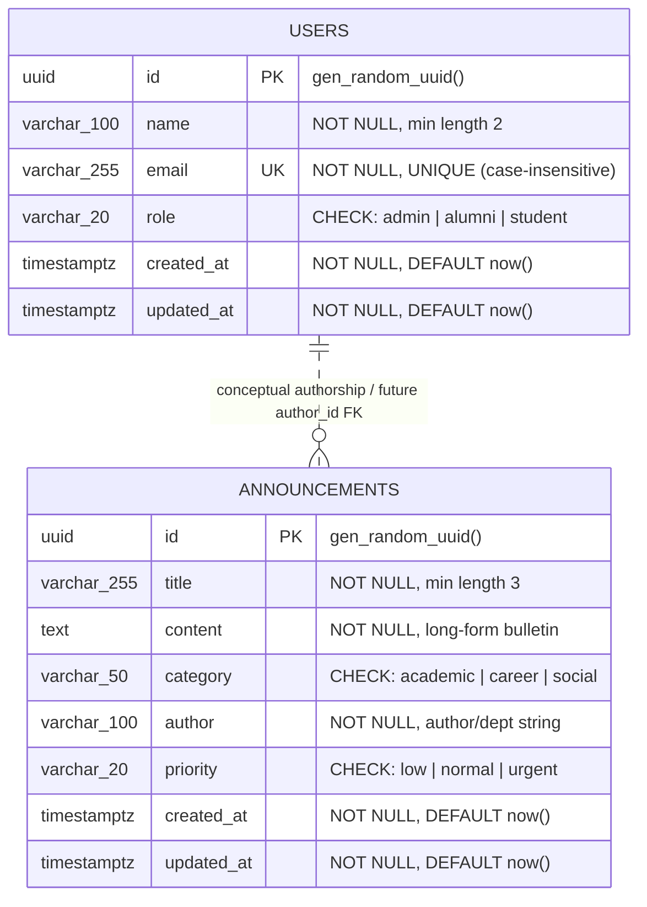

# Data Design Document (DDD)
## Alumni Tracking System — Database Integration, Persistence & Migration (Week 5)

> 🔗 **Bidirectional Documentation Link**:
> This document specifies the persistent data tier and relational architecture for the system described in the main [README.md](./README.md).
> To return to the main project overview, architecture diagrams, and API guides, see [README.md](./README.md).

---

## 📋 Table of Contents

1. [Executive Summary & Purpose](#1-executive-summary--purpose)
2. [Infrastructure & Persistence Model](#2-infrastructure--persistence-model)
3. [Entity Schema Specifications](#3-entity-schema-specifications)
   - [3.1 Entity: `users`](#31-entity-users)
   - [3.2 Entity: `announcements`](#32-entity-announcements)
4. [Data Types & Constraints Matrix](#4-data-types--constraints-matrix)
5. [Indexing Strategy & Performance Analysis](#5-indexing-strategy--performance-analysis)
6. [Relational Rationale & Architectural Evolution](#6-relational-rationale--architectural-evolution)
7. [Entity-Relationship (ER) Diagram](#7-entity-relationship-er-diagram)
8. [PostgreSQL DDL Reference Script](#8-postgresql-ddl-reference-script)
9. [Environment Configuration & Secrets Strategy](#9-environment-configuration--secrets-strategy)
10. [Migration & Seed Strategy](#10-migration--seed-strategy)
11. [Navigation](#11-navigation)

---

## 1. Executive Summary & Purpose

In Weeks 3 and 4, the **Alumni Tracking System** operated using an in-memory repository architecture with thread-safe defensive deep cloning to satisfy strict milestone isolation.

**Week 5 Milestone ("Database Integration, Persistence & Migration")** formalizes the migration from ephemeral in-memory storage to an enterprise-grade **PostgreSQL 16** relational database engine. This Data Design Document (DDD) establishes the formal database contract, relational schemas, constraint rules, index strategy, and persistence topology required to achieve durable ACID compliance while preserving backward compatibility with existing REST endpoints and MVC views.

---

## 2. Infrastructure & Persistence Model

### 2.1 Topology & Container Orchestration

The database engine is deployed as an isolated microservice container within Docker Compose:

* **Container / Service Name**: `alumni_postgres`
* **Base Image**: `postgres:16-alpine` (lightweight, minimal attack surface, security audited)
* **Isolated Network**: `alumni_network` (bridge network shared with `alumni_backend`)
* **Default Port**: `5432` (mapped dynamically via `${DB_PORT:-5432}:5432`)
* **Persistent Named Volume**: `postgres_data` mapped to `/var/lib/postgresql/data`

### 2.2 Persistence Guarantee (Named Docker Volume)

Ephemeral container lifecycles must **never** lead to data loss. The database configuration enforces persistence via a top-level named volume:

```yaml
services:
  alumni_postgres:
    image: postgres:16-alpine
    container_name: alumni_postgres
    restart: unless-stopped
    volumes:
      - postgres_data:/var/lib/postgresql/data
    healthcheck:
      test: ["CMD-SHELL", "pg_isready -U ${DB_USER:-alumni_user} -d ${DB_NAME:-alumni_db}"]
      interval: 5s
      timeout: 5s
      retries: 5
      start_period: 10s

volumes:
  postgres_data:
    driver: local
```

* **Durability Guarantee**: PostgreSQL WAL (Write-Ahead Logging) files, system catalogs, and table data reside inside the named volume `postgres_data`. Stopping (`docker compose down`), rebuilding images (`--build`), or restarting containers preserves all persistent state.
* **Volume Isolation**: The named volume is isolated from the host filesystem's working directory, preventing accidental modification, host OS permissions collisions, or git commits of binary database files.

### 2.3 Dependency & Health Coordination

The backend service coordinates startup using Docker's native healthcheck probe:

```yaml
backend:
  depends_on:
    alumni_postgres:
      condition: service_healthy
```

The healthcheck executes `pg_isready -U ${DB_USER:-alumni_user} -d ${DB_NAME:-alumni_db}` every 5 seconds. The backend container boots only after PostgreSQL has initialized the database catalog, started the TCP listener on port 5432, and reported ready to accept client connections.

---

## 3. Entity Schema Specifications

### 3.1 Entity: `users`

The `users` entity models registered alumni, students, and administrators within the system.

#### Table Definition
* **Table Name**: `users`
* **Primary Key**: `id` (`UUID`)

#### Column Specifications

| Column Name | PostgreSQL Type | Nullable | Default | Constraints & Checks | Rationale |
| :--- | :--- | :--- | :--- | :--- | :--- |
| `id` | `UUID` | **NOT NULL** | `gen_random_uuid()` | `PRIMARY KEY` | Globally unique 128-bit RFC 4122 identifier. Mitigates sequential ID enumeration attacks, facilitates distributed generation, and decouples identity from storage order. |
| `name` | `VARCHAR(100)` | **NOT NULL** | *None* | `CHECK (LENGTH(TRIM(name)) >= 2)` | Enforces human-readable names with a reasonable upper boundary (100 characters) and minimum length of 2 characters. |
| `email` | `VARCHAR(255)` | **NOT NULL** | *None* | `UNIQUE`, `CHECK (email ~* '^[A-Za-z0-9._%+-]+@[A-Za-z0-9.-]+\.[A-Za-z]{2,}$')` | RFC 5321 compliant email address. Enforces table-level uniqueness to prevent duplicate registrations and canonical identity collisions. |
| `role` | `VARCHAR(20)` | **NOT NULL** | `'student'` | `CHECK (role IN ('admin', 'alumni', 'student'))` | Role-Based Access Control (RBAC) discriminator. Constrained to enumerated valid roles to maintain domain integrity. |
| `created_at` | `TIMESTAMPTZ` | **NOT NULL** | `CURRENT_TIMESTAMP` | *Immutable on update* | UTC timestamp recording record creation instant. Timezone-aware (`TIMESTAMPTZ`) ensures correct internationalization across distributed clients. |
| `updated_at` | `TIMESTAMPTZ` | **NOT NULL** | `CURRENT_TIMESTAMP` | *Updated via trigger* | UTC timestamp capturing the latest mutation. Maintained automatically by a PostgreSQL trigger. |

---

### 3.2 Entity: `announcements`

The `announcements` entity models institution-wide bulletins, career fairs, academic notices, and alumni networking opportunities.

#### Table Definition
* **Table Name**: `announcements`
* **Primary Key**: `id` (`UUID`)

#### Column Specifications

| Column Name | PostgreSQL Type | Nullable | Default | Constraints & Checks | Rationale |
| :--- | :--- | :--- | :--- | :--- | :--- |
| `id` | `UUID` | **NOT NULL** | `gen_random_uuid()` | `PRIMARY KEY` | 128-bit UUID primary key ensuring collision-free identification across distributed environments. |
| `title` | `VARCHAR(255)` | **NOT NULL** | *None* | `CHECK (LENGTH(TRIM(title)) >= 3)` | Headline of the bulletin. 255 characters accommodate descriptive headlines for cards, banners, and RSS headlines. |
| `content` | `TEXT` | **NOT NULL** | *None* | `CHECK (LENGTH(TRIM(content)) > 0)` | Unbounded long-form textual body accommodating multi-paragraph announcements, rich markdown, or agenda descriptions. |
| `category` | `VARCHAR(50)` | **NOT NULL** | *None* | `CHECK (category IN ('academic', 'career', 'social'))` | Categorical discriminator supporting UI tab filters, subscription channels, and targeted bulletin feeds. |
| `author` | `VARCHAR(100)` | **NOT NULL** | *None* | `CHECK (LENGTH(TRIM(author)) >= 2)` | Author or issuing institutional entity (e.g. "Career Development Center", "Alumni Relations Office", or user name). |
| `priority` | `VARCHAR(20)` | **NOT NULL** | `'normal'` | `CHECK (priority IN ('low', 'normal', 'urgent'))` | Urgency classification. Drives UI badge colorization (e.g., red for urgent, blue for normal) and notification sorting. |
| `created_at` | `TIMESTAMPTZ` | **NOT NULL** | `CURRENT_TIMESTAMP` | *Immutable on update* | Timezone-aware UTC timestamp used for reverse-chronological feed sorting (`ORDER BY created_at DESC`). |
| `updated_at` | `TIMESTAMPTZ` | **NOT NULL** | `CURRENT_TIMESTAMP` | *Updated via trigger* | Timezone-aware UTC timestamp recording the latest edit time. |

---

## 4. Data Types & Constraints Matrix

### 4.1 Global Design Conventions

1. **UUID Identifier Standard**: All primary keys utilize native PostgreSQL `UUID` generated by `gen_random_uuid()` (via `pgcrypto` or native PostgreSQL 13+).
2. **Explicit Timezone Representation**: Timestamps use `TIMESTAMPTZ` (`TIMESTAMP WITH TIME ZONE`). Storage is normalized internally to UTC; client applications format values according to their local timezone.
3. **Defense-in-Depth Constraints**: Data integrity is enforced at the database level (`NOT NULL`, `CHECK`, `UNIQUE`) in addition to application-level validation layers (`user.service.js`, `announcement.service.js`).
4. **String Trimming & Length Bounds**: Uncontrolled string inflation is prevented by bounding VARCHAR sizes (`VARCHAR(100)`, `VARCHAR(255)`), while `TEXT` is reserved for large document bodies (`announcements.content`).

---

## 5. Indexing Strategy & Performance Analysis

To guarantee scalable sub-millisecond query performance as datasets grow, the following B-Tree indexes are defined:

```
┌────────────────────────────────────────────────────────────────────────┐
│                        PostgreSQL B-Tree Indexes                       │
├──────────────────────────┬───────────────────────┬─────────────────────┤
│ Table                    │ Index Name            │ Indexed Expression  │
├──────────────────────────┼───────────────────────┼─────────────────────┤
│ users                    │ users_pkey            │ (id) UNIQUE         │
│ users                    │ idx_users_email_lower │ (LOWER(email)) UNIQ │
│ users                    │ idx_users_role        │ (role)              │
│ announcements            │ announcements_pkey    │ (id) UNIQUE         │
│ announcements            │ idx_announcements_cr  │ (created_at DESC)   │
│ announcements            │ idx_announcements_cat │ (category, created) │
│ announcements            │ idx_announcements_pri │ (priority)          │
└──────────────────────────┴───────────────────────┴─────────────────────┘
```

### 5.1 `users` Table Indexes

1. **`users_pkey` (Primary Key Index)**:
   * **Target**: `id`
   * **Structure**: Unique B-Tree
   * **Query Profile**: `GET /api/users/:id`, `PUT /api/users/:id`, `DELETE /api/users/:id`. Provides $O(\log N)$ single-record retrieval.
2. **`idx_users_email_lower` (Case-Insensitive Unique Index)**:
   * **Target**: `LOWER(email)`
   * **Structure**: Unique Functional B-Tree
   * **Query Profile**: `POST /api/users` conflict checks and authentication lookups (`WHERE LOWER(email) = LOWER($1)`). Guarantees that `user@alumni.edu` and `User@Alumni.edu` cannot co-exist.
3. **`idx_users_role` (Role Filter Index)**:
   * **Target**: `role`
   * **Structure**: B-Tree
   * **Query Profile**: `GET /api/users?role=alumni` or filtering by `admin`/`student` in directory views.

### 5.2 `announcements` Table Indexes

1. **`announcements_pkey` (Primary Key Index)**:
   * **Target**: `id`
   * **Structure**: Unique B-Tree
   * **Query Profile**: Direct single-bulletin lookups, edits, and deletions (`GET /api/announcements/:id`).
2. **`idx_announcements_created_at_desc` (Chronological Feed Index)**:
   * **Target**: `created_at DESC`
   * **Structure**: B-Tree (Descending order)
   * **Query Profile**: Home page bulletin feeds, RSS feeds, and paginated lists (`SELECT * FROM announcements ORDER BY created_at DESC LIMIT 20`). Eliminates runtime sorting overhead (`Sort` node in `EXPLAIN ANALYZE`).
3. **`idx_announcements_category_created_at` (Composite Filter-Sort Index)**:
   * **Target**: `(category, created_at DESC)`
   * **Structure**: Composite B-Tree
   * **Query Profile**: Category-filtered feeds (`WHERE category = 'career' ORDER BY created_at DESC`). Serves filtered and pre-sorted results directly from the index tree.
4. **`idx_announcements_priority` (Priority Filter Index)**:
   * **Target**: `priority`
   * **Structure**: B-Tree
   * **Query Profile**: Alert banner retrieval (`WHERE priority = 'urgent'`).

---

## 6. Relational Rationale & Architectural Evolution

### 6.1 Current Phase Design: Standalone `author VARCHAR(100)`

In the current schema, `announcements.author` is stored as a `VARCHAR(100)` string rather than a rigid foreign key to `users.id`. This deliberate design decision provides:

1. **Institutional Authorship**: High-priority announcements are frequently published on behalf of departments or administrative entities (e.g. *"Alumni Relations Office"*, *"Career Development Center"*, *"Office of the Dean"*) rather than a single individual.
2. **Loose Coupling & Separation of Concerns**: Announcements can exist independently of individual user accounts, avoiding dummy "department user" records with synthetic emails.
3. **Contract Compatibility**: Maintains complete compatibility with the Week 4 in-memory announcement contract (`AnnouncementModel` seed data: `'Alumni Relations Office'`, `'Career Development Center'`, `'School of Computing & Engineering'`).

### 6.2 Future Relational Evolution (Phase 2+ Hybrid Model)

As the platform evolves toward authenticated sessions and multi-tenant editorial workflows, the schema provides a non-breaking evolutionary path:

* **Optional Foreign Key**: Add an `author_id UUID NULL REFERENCES users(id) ON DELETE SET NULL`.
* **Hybrid Fallback**:
  * If published by a logged-in user: `author_id` references the user's UUID, while `author` holds their display name snapshot.
  * If published by an institution or department: `author_id` is `NULL`, and `author` stores the department title.
* **Audit Protection**: If an author user account is deleted, `ON DELETE SET NULL` preserves the historical announcement while clearing the foreign key link.

---

## 7. Entity-Relationship (ER) Diagram



---

## 8. PostgreSQL DDL Reference Script

The complete Data Definition Language (DDL) migration script for creating the schemas, constraints, automated timestamp triggers, and indexes:

```sql
-- =============================================================================
-- Alumni Tracking System: Week 5 Database Schema Migration
-- Target Engine: PostgreSQL 16
-- Database: alumni_db
-- =============================================================================

-- Ensure cryptographic extension is available for UUID generation
CREATE EXTENSION IF NOT EXISTS "pgcrypto";

-- -----------------------------------------------------------------------------
-- Automated updated_at Trigger Function
-- -----------------------------------------------------------------------------
CREATE OR REPLACE FUNCTION update_updated_at_column()
RETURNS TRIGGER AS $$
BEGIN
    NEW.updated_at = CURRENT_TIMESTAMP;
    RETURN NEW;
END;
$$ LANGUAGE plpgsql;

-- -----------------------------------------------------------------------------
-- Table: users
-- -----------------------------------------------------------------------------
CREATE TABLE IF NOT EXISTS users (
    id UUID PRIMARY KEY DEFAULT gen_random_uuid(),
    name VARCHAR(100) NOT NULL,
    email VARCHAR(255) NOT NULL,
    role VARCHAR(20) NOT NULL DEFAULT 'student',
    created_at TIMESTAMPTZ NOT NULL DEFAULT CURRENT_TIMESTAMP,
    updated_at TIMESTAMPTZ NOT NULL DEFAULT CURRENT_TIMESTAMP,

    -- Data Constraints
    CONSTRAINT chk_users_name_length CHECK (LENGTH(TRIM(name)) >= 2),
    CONSTRAINT chk_users_role CHECK (role IN ('admin', 'alumni', 'student')),
    CONSTRAINT chk_users_email_format CHECK (
        email ~* '^[A-Za-z0-9._%+-]+@[A-Za-z0-9.-]+\.[A-Za-z]{2,}$'
    )
);

-- Case-Insensitive Unique Index on users.email
CREATE UNIQUE INDEX IF NOT EXISTS idx_users_email_lower ON users (LOWER(TRIM(email)));

-- Filter index for role-based queries
CREATE INDEX IF NOT EXISTS idx_users_role ON users (role);

-- Attach automated updated_at trigger
DROP TRIGGER IF EXISTS trigger_users_updated_at ON users;
CREATE TRIGGER trigger_users_updated_at
    BEFORE UPDATE ON users
    FOR EACH ROW
    EXECUTE FUNCTION update_updated_at_column();

-- -----------------------------------------------------------------------------
-- Table: announcements
-- -----------------------------------------------------------------------------
CREATE TABLE IF NOT EXISTS announcements (
    id UUID PRIMARY KEY DEFAULT gen_random_uuid(),
    title VARCHAR(255) NOT NULL,
    content TEXT NOT NULL,
    category VARCHAR(50) NOT NULL,
    author VARCHAR(100) NOT NULL,
    priority VARCHAR(20) NOT NULL DEFAULT 'normal',
    created_at TIMESTAMPTZ NOT NULL DEFAULT CURRENT_TIMESTAMP,
    updated_at TIMESTAMPTZ NOT NULL DEFAULT CURRENT_TIMESTAMP,

    -- Data Constraints
    CONSTRAINT chk_announcements_title_length CHECK (LENGTH(TRIM(title)) >= 3),
    CONSTRAINT chk_announcements_content_length CHECK (LENGTH(TRIM(content)) > 0),
    CONSTRAINT chk_announcements_author_length CHECK (LENGTH(TRIM(author)) >= 2),
    CONSTRAINT chk_announcements_category CHECK (category IN ('academic', 'career', 'social')),
    CONSTRAINT chk_announcements_priority CHECK (priority IN ('low', 'normal', 'urgent'))
);

-- Chronological Feed Index (Descending)
CREATE INDEX IF NOT EXISTS idx_announcements_created_at_desc 
    ON announcements (created_at DESC);

-- Composite Category + Chronological Index
CREATE INDEX IF NOT EXISTS idx_announcements_category_created_at 
    ON announcements (category, created_at DESC);

-- Priority Filter Index
CREATE INDEX IF NOT EXISTS idx_announcements_priority 
    ON announcements (priority);

-- Attach automated updated_at trigger
DROP TRIGGER IF EXISTS trigger_announcements_updated_at ON announcements;
CREATE TRIGGER trigger_announcements_updated_at
    BEFORE UPDATE ON announcements
    FOR EACH ROW
    EXECUTE FUNCTION update_updated_at_column();
```

---

## 9. Environment Configuration & Secrets Strategy

### 9.1 Environment Variables Matrix

The database connection parameters are passed to both the containerized database and backend service through environment variables:

| Variable | Target Value | Container Context | Description |
| :--- | :--- | :--- | :--- |
| `DB_HOST` | `alumni_postgres` | `backend` | Docker internal DNS resolver host for PostgreSQL container |
| `DB_PORT` | `5432` | `backend` & `alumni_postgres` | Standard PostgreSQL port |
| `DB_NAME` | `alumni_db` | `backend` & `alumni_postgres` | Target database catalog name |
| `DB_USER` | `alumni_user` | `backend` & `alumni_postgres` | Database administrator/application user |
| `DB_PASSWORD` | `alumni_secure_password` | `backend` & `alumni_postgres` | High-entropy password for authentication |

### 9.2 Secrets Management & Version Control Defense

* **`.gitignore` Enforcement**: `.env` is explicitly declared in `.gitignore` to prevent database credentials and secret tokens from ever leaking to public Git repositories.
* **`.env.example` Synchronization**: `.env.example` is maintained under version control as a template reference, allowing any developer to initialize their environment deterministically (`cp .env.example .env`).

---

## 10. Migration & Seed Strategy

### 10.1 Seed Data Preservation

When migrations run, the database is pre-seeded with initial records mirroring the Week 3 and Week 4 test baselines to ensure test suites and views remain completely intact:

* **Initial Users**:
  1. `11111111-1111-4111-a111-111111111111`: Ada Lovelace (`ada.lovelace@alumni.edu`, `admin`)
  2. `22222222-2222-4222-a222-222222222222`: Alan Turing (`alan.turing@alumni.edu`, `alumni`)
  3. `33333333-3333-4333-a333-333333333333`: Grace Hopper (`grace.hopper@alumni.edu`, `alumni`)
  4. `44444444-4444-4444-a444-444444444444`: Margaret Hamilton (`margaret.hamilton@alumni.edu`, `student`)

* **Initial Announcements**:
  1. `a1111111-1111-4111-a111-111111111111`: *Annual Alumni Homecoming 2026* (`social`, `urgent`, `Alumni Relations Office`)
  2. `b2222222-2222-4222-a222-222222222222`: *Fall Tech & Engineering Career Fair 2026* (`career`, `normal`, `Career Development Center`)
  3. `c3333333-3333-4333-a333-333333333333`: *Distinguished Guest Speaker Series: Quantum Computing* (`academic`, `normal`, `School of Computing & Engineering`)

---

## 11. Navigation

* ⬅️ **Return to Project Documentation**: [README.md](./README.md)
* 🏛️ **MVC Architecture & Dual Controllers**: [README.md#mvc-architecture-specification](./README.md#-mvc-architecture-specification)
* 🧪 **Automated Test Suite**: [README.md#local-development--testing](./README.md#-local-development--testing)
* 🐳 **Containerization Specification**: [README.md#containerization-details](./README.md#-containerization-details)
